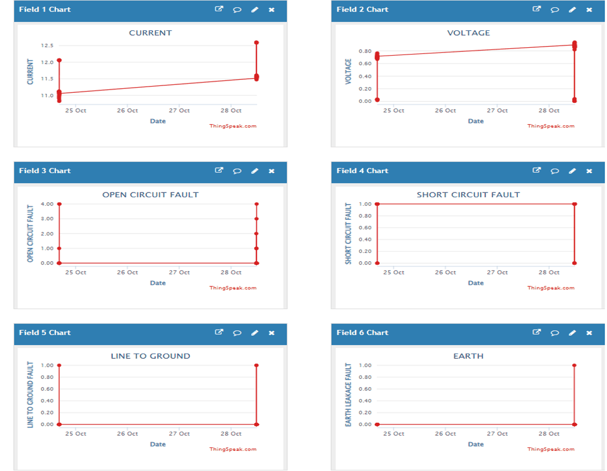
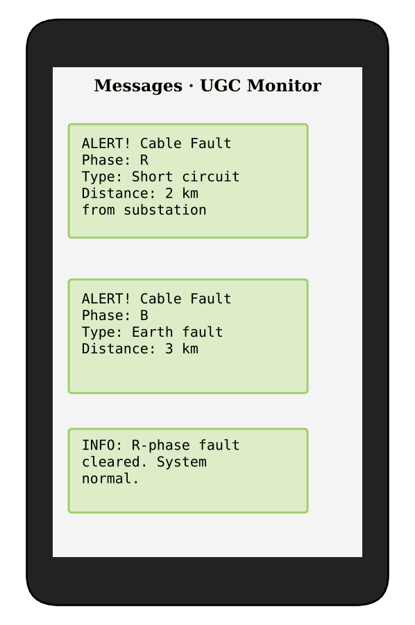
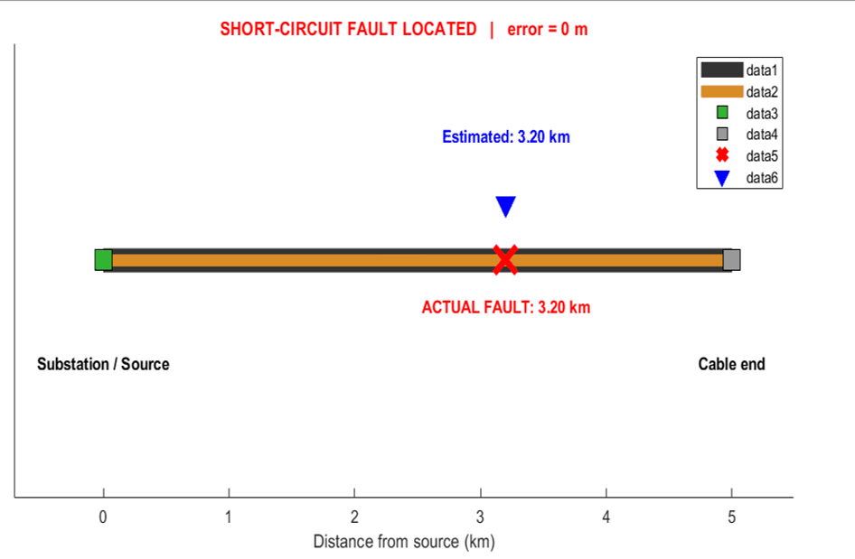
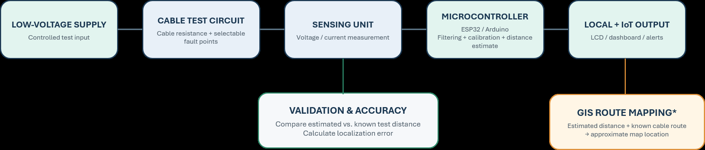

# IoT Framework for Underground Cable Fault Detection and Localization

Prototype project files for detecting cable fault conditions, monitoring electrical measurements, and estimating fault location.

## Project files

- `IOT_Fault_detection_code.ino` — ESP32-based hardware firmware with voltage/current sensing, fault-switch inputs, LCD status, relay control, ThingSpeak telemetry, and GSM SMS alerts.
- `concept_test.m` — MATLAB concept model for estimating short-circuit distance and illustrating open-circuit RC charging.
- `ThreePhaseFaultDetection_simulink.mlx` — MATLAB Live Script for three-phase fault data generation and model-based fault detection.

## Hardware and software

The firmware uses Wi-Fi, ThingSpeak, a 16×2 LCD, a GSM modem, voltage/current sensors, fault switches, and controlled loads. It is written for an ESP32 Arduino environment and uses the ThingSpeak Arduino library.

The MATLAB files require MATLAB. The Live Script also references these Simulink model files, which were not present in the supplied project folder:

- `PowerTransmissionModel.slx`
- `TrainingModel.slx`
- `FaultDetectionModel.slx`

Add the corresponding models and any required MATLAB toolboxes before running the Live Script.

## Configuration and privacy

The public firmware copy replaces the ThingSpeak write key with `YOUR_THINGSPEAK_WRITE_API_KEY` and sets the channel ID to `0`. Configure your own channel ID and write key locally before connecting the device. The Wi-Fi and SMS recipient values in the sketch are placeholders. Keep real credentials and phone numbers out of public commits.

## Prototype status

This repository contains project source files only. Hardware behavior and MATLAB/Simulink execution have not been validated as part of repository setup. Verify sensor calibration, relay logic, and communications with safe test equipment before connecting field hardware.

## ThingSpeak monitoring

Example dashboard screenshot showing current, voltage, and fault-status channels. The image is a supplied project output, not a live-verified dashboard capture.

## Fault notifications

The supplied interface illustrates cable-fault alerts with phase, fault type, estimated distance, and a fault-cleared status message.

## Fault detection and localization output

Example short-circuit localization result showing the estimated and actual fault positions.

## System flowchart

Concept flow from the low-voltage test supply and cable circuit through sensing and microcontroller processing to local/IoT outputs. The diagram also shows validation and optional route mapping.

## Topics

`iot` · `arduino` · `esp32` · `matlab` · `simulink` · `cable-fault-detection` · `fault-localization` · `thingspeak`

